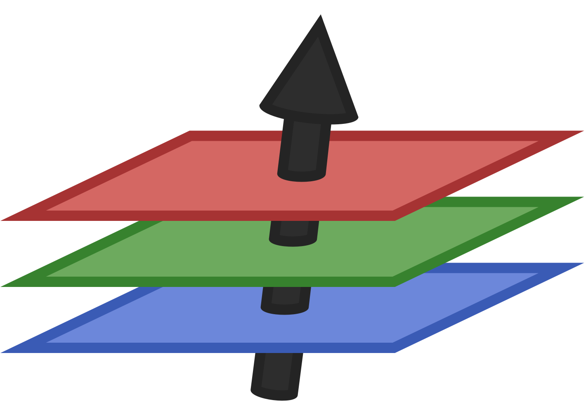

# NNlib.jl

[![Documentation][docs-dev-img]][docs-dev-url]
[](https://github.com/FluxML/NNlib.jl/actions/workflows/ci.yml)
[](https://codecov.io/gh/FluxML/NNlib.jl) 

[docs-stable-img]: https://img.shields.io/badge/docs-stable-blue.svg
[docs-stable-url]: https://fluxml.ai/NNlib.jl/stable/

[docs-dev-img]: https://img.shields.io/badge/docs-latest-blue.svg
[docs-dev-url]: https://fluxml.ai/NNlib.jl/dev/

This package provides a library of functions useful for neural networks, such as softmax, sigmoid, batched multiplication, convolutions and pooling. Many of these are used by [Flux.jl](https://github.com/FluxML/Flux.jl), which loads this package, but they may be used independently.

For use with automatic differentiation (AD), this package defines gradients for its functions. AD packages are supported in two tiers:

- **First tier:** [Zygote.jl](https://github.com/FluxML/Zygote.jl) and [Enzyme.jl](https://github.com/EnzymeAD/Enzyme.jl). Gradient tests check both. Zygote uses the rules defined with [ChainRules.jl](https://github.com/JuliaDiff/ChainRules.jl), which other ChainRules-based packages also use. Enzyme's rules are in a package extension that `using Enzyme` loads.
- **Second tier, experimental:** [Mooncake.jl](https://github.com/chalk-lab/Mooncake.jl), loaded with `using Mooncake`. It has its own, smaller test suite. Expect missing rules and bugs, and please report them.

GPU support is provided as package extensions (see the `ext/` folder). In order to load the extensions, use the imports
```julia
using NNlib, CUDA, cuDNN
```
for CUDA support, or
```julia
using NNlib, AMDGPU
```
for AMDGPU support.
